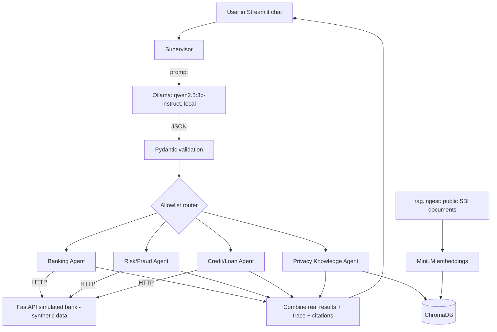

# 🏦 BankMate AI: Privacy-Aware Multi-Agent Banking Assistant

> **An independent educational simulation.** All customers, accounts and transactions are **synthetic**.
> BankMate AI uses *publicly available* SBI documents only to demonstrate privacy-policy question answering (RAG).
> It is **not** an official SBI or banking service, is **not** affiliated with, endorsed by or compliant with SBI,
> never connects to any real bank system, and makes **no real credit decisions**.

BankMate AI is a local, CPU-friendly multi-agent system built for the assignment
*"Build an Application for Simulated Real-Time Banking Architecture with Multi-Agent Automation using Experimental Models."*
A **Supervisor agent** uses a local LLM to understand a message, validates the result, and routes it through a fixed allowlist to
specialised agents that call a **simulated banking REST API** or a **vector database of public SBI documents**.

---

## Table of contents
1. [Features](#-features)
2. [Architecture](#-architecture)
3. [Tech stack and models](#-tech-stack-and-models)
4. [Project structure](#-project-structure)
5. [Prerequisites](#-prerequisites)
6. [Quick start (Windows)](#-quick-start-windows)
7. [Step-by-step execution guide](#-step-by-step-execution-guide)
8. [Using the app](#-using-the-app)
9. [Demo customers](#-demo-customers)
10. [API reference](#-api-reference)
11. [Configuration](#-configuration)
12. [Running tests](#-running-tests)
13. [Privacy and safety design](#-privacy-and-safety-design)
14. [Limitations](#-limitations)
15. [Troubleshooting](#-troubleshooting)
16. [Uploading to GitHub](#-uploading-this-project-to-github)
17. [Disclaimer](#-disclaimer)

---

## ✨ Features
- **Supervisor / orchestrator agent**: local LLM → structured JSON intents → Pydantic validation → deterministic **allowlist routing**. Model output is never executed.
- **Four specialised agents**
  - **Banking Agent**: customer profile, balance, recent transactions.
  - **Risk/Fraud Agent**: transparent, configurable rules. A hit is a *risk alert for review*, never "confirmed fraud".
  - **Credit/Loan Agent**: EMI and a configurable debt-to-income demo rule, with explanations. Clearly labelled as an educational estimate.
  - **Privacy Knowledge Agent**: RAG over public SBI documents with numbered citations, page numbers (PDF) and source links.
- **Multi-agent requests**: one message can invoke several agents; their real outputs are combined into one answer.
- **Simulated banking API** (FastAPI + Pydantic) with validated schemas and clear HTTP status codes.
- **Streamlit app**: dashboard (account cards, transactions, risk alerts, loan estimator) and an **Assistant chat** that also answers privacy-policy questions, with an expandable **Agent activity** trace.
- **Privacy by design**: synthetic data only, local inference, credential-like input is blocked, no conversation storage, chat clears on customer switch.
- **Deterministic mock mode** and **87 Pytest tests** that need no LLM, no running API and no internet.

## 🧭 Architecture



**Core principle:** the LLM handles *language* (intent detection and phrasing the privacy answer). Balances, transactions, alerts and loan numbers always come from the API and deterministic code, rendered by templates, so the model cannot invent them.

More detail in [`docs/architecture.md`](docs/architecture.md).

## 🧰 Tech stack and models

| Layer | Technology |
|---|---|
| Language | Python 3.10 to 3.12 |
| UI | Streamlit (≥ 1.50) |
| Banking API | FastAPI + Uvicorn, Pydantic v2 |
| LLM runtime / model | [Ollama](https://ollama.com) · `qwen2.5:3b-instruct` (quantized, CPU) |
| Embeddings | `sentence-transformers/all-MiniLM-L6-v2` (384 dimensions, CPU, cached in `.cache/models`) |
| Vector database | ChromaDB (persistent, cosine distance) |
| Document parsing | pypdf, BeautifulSoup4 |
| Tests | Pytest |

No TensorFlow/Keras and no GPU required. Change the model with `OLLAMA_MODEL` in `.env`.

## 📁 Project structure
```text
bankmate-ai/
├── app.py                  # Streamlit UI (dashboard + assistant chat)
├── supervisor.py           # Orchestrator: guards, classification, routing, combining
├── intents.py              # Intent schema, validation, parameter extraction, keyword classifier
├── llm.py                  # Ollama client + typed errors
├── formatting.py           # Turns real agent data into readable text
├── config.py               # Settings read from environment variables
├── requirements.txt  .env.example  .gitignore  pytest.ini
├── setup.ps1  run_api.ps1  run_app.ps1  run_ingest.ps1  run_tests.ps1
├── agents/                 # banking_agent, risk_agent, credit_agent, privacy_agent, base
├── tools/                  # banking_tools (API client), risk_tools (rules), credit_tools (EMI/DTI)
├── api/                    # main, routes, schemas, store (simulated bank)
├── rag/                    # document_loader, embeddings, ingest, retriever
├── data/
│   ├── demo_data.json      # synthetic customers and transactions
│   └── sbi_docs/           # manual-import folder + sources.example.json
├── tests/                  # 87 tests
└── docs/                   # architecture, demo script, interview notes
```

## ✅ Prerequisites
| Requirement | Notes |
|---|---|
| Windows 10/11 | Commands below use PowerShell (macOS/Linux users: see the note at the end of the quick start) |
| Python 3.10 to 3.12 | Installed with **"Add Python to PATH"** ticked. Check with `python --version` |
| [Ollama for Windows](https://ollama.com/download) | Runs in the background after install. Check with `ollama list` |
| ~6 GB free disk | Model (~2 GB), PyTorch, embedding model, packages |
| Internet (first time only) | To download packages and models |
| Recommended: VS Code + Python extension | Optional but convenient |

Hardware used for development: 16 GB RAM, integrated graphics, no dedicated GPU.

## 🚀 Quick start (Windows)

Open PowerShell **inside the project folder** (the folder that contains `app.py`):

```powershell
# 1. One-time setup
Set-ExecutionPolicy -Scope CurrentUser RemoteSigned   # allow local scripts
Get-ChildItem -Recurse | Unblock-File                  # needed if the project came from a ZIP download
.\setup.ps1                                            # venv + CPU PyTorch + dependencies + .env
ollama pull qwen2.5:3b-instruct                        # ~1.9 GB

# 2. Build the SBI knowledge base (one-time; see "Step 4" for manual download)
python -m rag.ingest --rebuild

# 3. Run (two terminals, both with the venv active)
uvicorn api.main:app --port 8000      # Terminal 1: simulated bank API
streamlit run app.py                  # Terminal 2: web app at http://localhost:8501
```

> **macOS / Linux:** create the venv with `python3 -m venv .venv && source .venv/bin/activate`, then
> `pip install -r requirements.txt` and use the same `uvicorn`, `python -m rag.ingest` and `streamlit` commands.
> The `.ps1` scripts are Windows-only conveniences. This project was developed and run on Windows.

## 📖 Step-by-step execution guide

### Step 1: Get the project
```powershell
git clone https://github.com/<your-username>/bankmate-ai.git
cd bankmate-ai
dir          # you should see app.py, setup.ps1, requirements.txt
```
If you downloaded a ZIP instead, extract it and open the folder that **directly contains** `app.py`. A ZIP often extracts one folder deeper (`bankmate-ai\bankmate-ai`). Running commands from the wrong folder causes `ModuleNotFoundError: config`.

### Step 2: Install (one time)
```powershell
Set-ExecutionPolicy -Scope CurrentUser RemoteSigned
.\setup.ps1
```
`setup.ps1` runs these steps; you can also run them yourself:
```powershell
python -m venv .venv
.\.venv\Scripts\Activate.ps1
python -m pip install --upgrade pip
pip install torch --index-url https://download.pytorch.org/whl/cpu   # CPU-only build (avoids a huge CUDA download)
pip install -r requirements.txt
Copy-Item .env.example .env
```
When finished, the prompt starts with `(.venv)`. Activate it in every new terminal with `.\.venv\Scripts\Activate.ps1`.

### Step 3: Download the local LLM
```powershell
ollama pull qwen2.5:3b-instruct
ollama list                    # confirm it is listed
```

### Step 4: Build the SBI knowledge base (RAG)
The Privacy Knowledge Agent answers only from public SBI documents stored in a local ChromaDB. You can load them automatically or by hand.

**Sources used**

| Document | URL |
|---|---|
| SBI Privacy Statement (PDF) | https://sbi.bank.in/documents/26274/109521/26122025_Private+Policy.pdf/ed6a8697-80ba-a1dc-8fc1-2c93c2c113a4?t=1766743311511 |
| SBI Contact Centre and Privacy Statement (web page) | https://sbi.co.in/web/customer-care/contact-centre |
| SBI Sustainability Report FY 2024-25 (PDF) | https://sbi.co.in/documents/17826/0/Sustainability%2BReport%2BFY%2B2024-25.pdf/600d0a64-b30b-c23e-7b71-5cb1e3fbb299?t=1751026510426 |

**Option A: automatic download**
```powershell
python -m rag.ingest --rebuild
```
Only official `sbi.co.in` and `sbi.bank.in` hosts are allowed, `robots.txt` is respected, and the tool prints a report marking each source **LOADED** or **MISSING** with the reason. If a site blocks automated access, use Option B.

**Option B: manual import (recommended if Option A shows MISSING)**
1. Open the document URL in your browser and save the PDF into `data\sbi_docs\` (for example `Private Policy.pdf`).
2. Copy the sources file so citations show the real title and link:
   ```powershell
   Copy-Item data\sbi_docs\sources.example.json data\sbi_docs\sources.json
   ```
   File names in `sources.json` are matched loosely (case, spaces and underscores are ignored). Edit the titles or URLs if you use different documents.
3. Build from local files only:
   ```powershell
   python -m rag.ingest --rebuild --skip-fetch
   ```
Only import documents SBI publishes publicly on its official pages. The downloaded files are **not** committed to GitHub (see `.gitignore`).

**Verify the knowledge base**
```powershell
python -m rag.retriever "what personal information does SBI collect"
```
Each line shows `distance  page  title | passage`. Lower distance means a closer match. Passages at or below `RAG_MAX_DISTANCE` (default 0.70) are used. If relevant text is rejected, raise the value slightly in `.env` (for example `0.80`).

The first ingest downloads the embedding model (~90 MB). A large PDF can take several minutes on CPU. You only repeat this step when you add or change documents.

### Step 5: Start the services

**Terminal 1: banking API**
```powershell
.\.venv\Scripts\Activate.ps1
uvicorn api.main:app --port 8000
```
Check http://localhost:8000/health → `{"status":"ok","data":"synthetic"}` and the interactive docs at http://localhost:8000/docs.

**Terminal 2: web app**
```powershell
.\.venv\Scripts\Activate.ps1
streamlit run app.py
```
The app opens at http://localhost:8501. Start the API **first**; the sidebar reports if it cannot be reached.

Convenience scripts do the same: `.\run_api.ps1`, `.\run_ingest.ps1`, `.\run_app.ps1`, `.\run_tests.ps1`.

### Step 6: Next time you come back
Nothing needs reinstalling. Open the project folder, make sure Ollama is running (`ollama list`), then repeat **Step 5** only. Re-run Step 4 only if you change documents.

### Using VS Code
1. **File → Open Folder** and choose the folder containing `app.py`.
2. **Ctrl + Shift + P → Python: Select Interpreter → `.venv\Scripts\python.exe`**.
3. Open the terminal with **Ctrl + `** (PowerShell) and use **Split Terminal** for the second process.
4. Tests: **Testing panel → Configure Python Tests → pytest**.

Optional `.vscode/launch.json` for one-click run/debug (F5):
```json
{
  "version": "0.2.0",
  "configurations": [
    { "name": "API (uvicorn)", "type": "debugpy", "request": "launch",
      "module": "uvicorn", "args": ["api.main:app", "--port", "8000"] },
    { "name": "Streamlit app", "type": "debugpy", "request": "launch",
      "module": "streamlit", "args": ["run", "app.py"] }
  ],
  "compounds": [ { "name": "API + Streamlit", "configurations": ["API (uvicorn)", "Streamlit app"] } ]
}
```

## 💬 Using the app
1. Choose a **synthetic demo customer** in the sidebar (demo selector only, not authentication).
2. **Dashboard tab:** balance and account cards, recent transactions, risk alerts, and an interactive loan estimator.
3. **Assistant chat tab:** click a suggested question or type your own. Banking questions use the selected synthetic customer; privacy questions are answered from the SBI documents with cited sources.
4. Expand **🔎 Agent activity** under any answer to see detected intents, selected agents, tools executed, status and any errors (including visible *fallback* steps if the LLM was unavailable).
5. **Clear chat** in the sidebar wipes the conversation. Switching customer also clears it.

**Sample questions**
1. Show my account balance.
2. Show my last five transactions.
3. Check whether any transactions look suspicious.
4. Estimate whether I may qualify for a loan of ₹2,00,000.
5. Show my transactions, check for suspicious activity and estimate my loan eligibility for ₹2,00,000.
6. What does the public SBI privacy statement say about customer information?
7. What personal information does SBI collect and how does it protect it?

**Demo without Ollama:** set `BANKMATE_MOCK_LLM=1` in `.env` and restart Streamlit. A keyword classifier replaces the LLM and privacy answers show the retrieved passages directly.

## 👥 Demo customers
All data is fictional. Names in your copy of `data/demo_data.json` may differ if you edited them; the IDs and behaviours stay the same.

| ID | Balance (₹) | What it demonstrates |
|---|---|---|
| CUST1001 | 85,420.50 | Clean account; ₹2,00,000 loan is within the demo limits |
| CUST1002 | 1,24,300.75 | ₹85,000 overseas transfer and 4 online purchases within 10 minutes → risk alerts |
| CUST1003 | 18,950.00 | Three identical ₹4,999 payments; ₹2,00,000 loan is outside the demo debt-to-income limit |
| CUST1004 | 3,45,000.00 | High income, no alerts |

## 🔌 API reference
Base URL `http://localhost:8000` (synthetic data only).

| Method | Path | Description | Errors |
|---|---|---|---|
| GET | `/customers` | List demo customers | |
| GET | `/customers/{id}` | Profile | 400 bad ID, 404 unknown |
| GET | `/customers/{id}/balance` | Balance | 400, 404 |
| GET | `/customers/{id}/transactions?limit=10` | Newest first, limit 1 to 100 | 400, 404, 422 |
| GET | `/customers/{id}/risk-alerts` | Rule-based alerts (not fraud verdicts) | 400, 404 |
| POST | `/loans/eligibility` | Educational loan estimate | 404, 422 |
| GET | `/health` | Liveness check | |

```powershell
curl http://localhost:8000/customers/CUST1001/balance
curl -X POST http://localhost:8000/loans/eligibility -H "Content-Type: application/json" -d "{\"customer_id\":\"CUST1001\",\"loan_amount\":200000,\"tenure_months\":36}"
```
(In PowerShell, `curl.exe` may be needed instead of the `curl` alias.)

## ⚙️ Configuration
Copy `.env.example` to `.env` (done by `setup.ps1`). Never commit `.env`.

| Variable | Default | Meaning |
|---|---|---|
| `OLLAMA_MODEL` | `qwen2.5:3b-instruct` | Model served by Ollama |
| `OLLAMA_BASE_URL` / `OLLAMA_TIMEOUT_SECONDS` | `http://localhost:11434` / `90` | Ollama address and timeout |
| `BANKMATE_MOCK_LLM` | `0` | `1` = deterministic mock mode (no LLM) |
| `BANK_API_BASE_URL` | `http://localhost:8000` | Where the app finds the banking API |
| `EMBEDDING_BACKEND` / `EMBEDDING_MODEL` | `sentence-transformers` / `all-MiniLM-L6-v2` | Embeddings (`hash` is a tiny test-only backend) |
| `CHROMA_DIR` / `CHROMA_COLLECTION` | `chroma_db` / `sbi_public_docs` | Vector store location |
| `RAG_TOP_K` / `RAG_MAX_DISTANCE` | `4` / `0.70` | Passages retrieved / relevance cut-off |
| `CHUNK_SIZE_CHARS` / `CHUNK_OVERLAP_CHARS` | `900` / `150` | Chunking |
| `RISK_LARGE_AMOUNT`, `RISK_BURST_COUNT`, `RISK_BURST_WINDOW_MINUTES`, `RISK_REPEAT_COUNT`, `RISK_DEMO_INDICATORS` | `50000`, `3`, `15`, `3`, `foreign_location,new_beneficiary` | Fraud-rule thresholds |
| `LOAN_MAX_DTI`, `LOAN_MIN_RESIDUAL_INCOME`, `LOAN_ANNUAL_INTEREST_PCT`, `LOAN_DEFAULT_TENURE_MONTHS` | `0.50`, `10000`, `10.5`, `36` | Demo loan rule (**not** official SBI criteria) |

Restart the API and Streamlit after editing `.env`; they do not reload it while running.

## 🧪 Running tests
```powershell
python -m pytest
```
87 tests cover: customer lookup, balances, transactions, unknown/malformed IDs, fraud rules (flagged and clean), EMI/eligibility, valid and invalid supervisor intents, multi-agent routing, combined responses, RAG ingestion/retrieval/citations, insufficient context, invalid model output, LLM timeout/outage and API error handling.

Tests force mock mode, use a tiny deterministic embedder and a temporary vector database, so they need **no Ollama, no running API and no SBI website**.

## 🔒 Privacy and safety design
| Safeguard | How |
|---|---|
| Synthetic data only | Fictional customers; dataset marked synthetic and tested |
| Local inference | Ollama on localhost; no private data sent to external LLM services |
| No credentials | Messages containing password/PIN/OTP/CVV/passcode or 12 to 19 digit numbers are blocked before processing |
| Restricted execution | Model output is validated JSON; only predefined agent functions are reachable through an allowlist; nothing from the model is executed |
| No invented facts | Numbers come from the API/rules and are templated; loan amounts are re-read from the user's text; privacy answers use only retrieved passages and say when information is insufficient |
| Alerts, not accusations | Rule hits are "risk alerts for review", never "confirmed fraud" |
| Minimal storage | Chat lives only in session memory and is cleared on request or customer switch |
| Secrets | `.env`, vector DB, model cache and downloaded documents are git-ignored; ChromaDB telemetry is off |
| Honest labelling | Disclaimers throughout; demo selector is not authentication; no compliance or SBI-affiliation claims |

## ⚠️ Limitations
- Simulated data and a demo customer selector; not production-grade security and no compliance assessment.
- A 3B quantized model can misread unusual phrasing; the keyword fallback is simple (fallbacks are shown in the trace).
- Fraud and loan rules are illustrative, not SBI criteria.
- Privacy answers are only as good as the ingested documents; retrieval is vector-only (no re-ranking or keyword hybrid) and `RAG_MAX_DISTANCE` may need tuning.
- Each message is handled independently (no follow-up memory). Scanned PDFs without a text layer are not supported (no OCR).

## 🛠️ Troubleshooting
| Problem | Fix |
|---|---|
| `.\setup.ps1 is not recognized` | You are in the wrong folder. Run `dir` and `cd` into the folder that contains `setup.ps1` and `app.py` (ZIPs often extract one level deeper) |
| `cannot be loaded. The file is not digitally signed` | `Get-ChildItem -Recurse \| Unblock-File`, or `Set-ExecutionPolicy -Scope Process -ExecutionPolicy Bypass` for the current window |
| `running scripts is disabled` | `Set-ExecutionPolicy -Scope CurrentUser RemoteSigned` |
| `ModuleNotFoundError: config` (or other project modules) | Run commands from the project root, with the venv active |
| `No module named streamlit` / package errors | Activate the venv (`.\.venv\Scripts\Activate.ps1`) and re-run `pip install -r requirements.txt` |
| Sidebar: "Banking API is not reachable" | Start `uvicorn api.main:app --port 8000` first. If you changed the port, update `BANK_API_BASE_URL` |
| "Ollama not running" / "Model missing" | Start Ollama; `ollama pull qwen2.5:3b-instruct`. The app still works with the keyword fallback |
| Very slow first answer | The model loads into RAM once (20 to 60 s). Increase `OLLAMA_TIMEOUT_SECONDS` if needed |
| "The knowledge base has not been built yet" | Run Step 4 (`python -m rag.ingest --rebuild`) |
| Ingest prints **MISSING** for a source | The site blocked automated access or there is no network. Use the manual import (Step 4, Option B) |
| Ingest "stored 0 chunks" with local files | Check the file is in `data\sbi_docs`, is a `.pdf/.html/.txt`, and has selectable text (not a scan) |
| Answers say "not enough information" for a relevant question | Run `python -m rag.retriever "your question"`; if distances are slightly above 0.70, raise `RAG_MAX_DISTANCE` (e.g. `0.80`) |
| "Index was built with X embeddings…" | `python -m rag.ingest --rebuild` (the embedding backend changed) |
| Citation shows `manual-import:filename.pdf` | Create `data\sbi_docs\sources.json` (copy the example) so the real title and URL are shown |
| Port 8000 or 8501 already in use | Use another port, e.g. `uvicorn api.main:app --port 8001` and set `BANK_API_BASE_URL=http://localhost:8001` |
| JSON error after editing customer data | Check `data/demo_data.json` for a missing quote or trailing comma. Keep IDs in the `CUST` + 4 digits format |
| Tests fail after renaming customers | Update the two assertions that check the original name of `CUST1001` in `tests/test_api.py` and `tests/test_banking.py` |

## ⬆️ Uploading this project to GitHub
Run these inside the folder that contains `app.py`:

```powershell
git init
git add .
git status                       # CHECK: .env, .venv, chroma_db, .cache and SBI PDFs must NOT be listed
git commit -m "Initial commit: BankMate AI"
git branch -M main
git remote add origin https://github.com/<your-username>/bankmate-ai.git
git push -u origin main
```
1. Create an empty repository named `bankmate-ai` on github.com first (no README/license, to avoid conflicts).
2. `.gitignore` already excludes `.env`, `.venv/`, `chroma_db/`, `.cache/`, `__pycache__/` and the downloaded SBI documents.
3. Verify no secrets are tracked: `git ls-files | findstr /i ".env"` should list only `.env.example`.
4. Optional: add screenshots (for example `docs/screenshots/dashboard.png`, `chat.png`) and reference them in this README with ``.
5. Optional: add a license file of your choice if you want others to reuse the code. None is included by default.

## 📄 Disclaimer
BankMate AI is an independent student project for educational and demonstration purposes. All banking data is synthetic. It uses publicly available SBI documents solely as retrieval material for privacy-policy questions. It does not connect to any SBI or other banking system, is not affiliated with or endorsed by SBI, does not claim regulatory compliance, and does not provide financial advice or real credit decisions. Do not enter real account numbers, passwords, PINs, OTPs, CVVs or other credentials.
